<p align="center"></p>

Challenge sources and CTFd definitions for the Friendly CTF 2026, a beginner-friendly capture the flag organised by Securinets INSAT. The event ran with two scoreboards, one for beginners and one global that also included the advanced teams; 383 teams appeared on the global board (369 beginner, 14 advanced). This is the organisers' copy: every challenge directory holds the files needed to import it into CTFd and, where the challenge runs a service, to host it.

## Layout

```
crypto/               17 challenges in three waves (Naruto, DragonBall, BLEACH); remote ones in crypto/deploy
forensics/            35 challenges in three waves
misc/                 8 challenges, most of them served over netcat
mobile/               16 challenges, all inside one Android app, plus the backend in mobile/deploy
OSINT/                12 challenges
pwn/                  29 challenges in three waves
reverse-engineering/  13 challenges: a beginner ladder, game hacking, a malware case, and others
web-exp/              18 challenges in three waves
```

A challenge directory holds some of: `challenge.yaml` / `challenge.yml` (the CTFd definition in the format `ctfcli` reads), `attachments/` or `dist/` (files given to players), `Dockerfile`, `docker-compose.yml` and `src/` (the service, for remote challenges), and `solver.py`, `solution.md`, `writeup.md` or `Read.md` (reference solves and notes, for some challenges).

## Challenges

**Mobile.** The whole category is a single Android app (`fadigattack.apk`, attached to First Contact) that talks to the backend in `mobile/deploy`. All 16 challenges are by fadigaa: [First Contact](https://khalilammar.me/writeups/friendly-ctf-first-contact), [Warmup](https://khalilammar.me/writeups/friendly-ctf-warmup), [Echoes](https://khalilammar.me/writeups/friendly-ctf-echoes), [What Remains](https://khalilammar.me/writeups/friendly-ctf-what-remains), [L0gIn](https://khalilammar.me/writeups/friendly-ctf-l0gin), [Off the Map](https://khalilammar.me/writeups/friendly-ctf-off-the-map), [Face to Face](https://khalilammar.me/writeups/friendly-ctf-face-to-face), [Open Lines](https://khalilammar.me/writeups/friendly-ctf-open-lines), [DOR](https://khalilammar.me/writeups/friendly-ctf-dor), [PINNED](https://khalilammar.me/writeups/friendly-ctf-pinned), [Forged Papers](https://khalilammar.me/writeups/friendly-ctf-forged-papers), [WideOpen](https://khalilammar.me/writeups/friendly-ctf-wideopen), [Strangers](https://khalilammar.me/writeups/friendly-ctf-strangers), [License](https://khalilammar.me/writeups/friendly-ctf-license), [Nobody Called](https://khalilammar.me/writeups/friendly-ctf-nobody-called), [Final Countdown](https://khalilammar.me/writeups/friendly-ctf-final-countdown).

**Reverse engineering.**

| Directory | Challenge | Author | Write-up |
|---|---|---|---|
| `doorman` | Doorman | fadigaa | [write-up](https://khalilammar.me/writeups/friendly-ctf-doorman) |
| `night_shift` | Night Shift | fadigaa | [write-up](https://khalilammar.me/writeups/friendly-ctf-shift) |
| `broken_lock` | Broken Lock | fadigaa | [write-up](https://khalilammar.me/writeups/friendly-ctf-patch-and-go) |
| `paper_trail` | Paper Trail | fadigaa | [write-up](https://khalilammar.me/writeups/friendly-ctf-paper-trail) |
| `dead_air` | Dead Air | fadigaa | [write-up](https://khalilammar.me/writeups/friendly-ctf-relay) |
| `straight_key` | Straight Key | fadigaa | [write-up](https://khalilammar.me/writeups/friendly-ctf-straight-key) |
| `game-hacking/water_run` | Water Run | fadigaa | [write-up](https://khalilammar.me/writeups/friendly-ctf-water-run) |
| `game-hacking/water_run_revenge` | Water Run: Revenge | fadigaa | [write-up](https://khalilammar.me/writeups/friendly-ctf-water-run-revenge) |
| `malware-analysis/sample` | Sample (malware case 01) | fadigaa | none |
| `IDA` | XOR Me | Jed Jmili | none |
| `strings` | Welcome | Jed Jmili | none |
| `upx` | Revenge | Jed Jmili | none |
| `buvette` | Buvette INSAT | Jed Jmili | none |

The titles players saw may differ from the directory names (Night Shift, Broken Lock and Dead Air appear as Shift, Patch&Go and Relay in the write-ups).

**Other categories.**

| Category | Challenges | Author in the challenge files | Notes |
|---|---|---|---|
| crypto | 17 | Jed Jmili (git history) | waves: Naruto, DragonBall, BLEACH; remote challenges in `crypto/deploy` |
| forensics | 35 | `securinets` (committed by Mohamed Aziz Haddadi) | waves 1 to 3 |
| misc | 8 | r3t0x (committed by Amdouni Ghaith) | most have a `Dockerfile` and a `solver.py` |
| pwn | 29 | r3t0x (committed by Amdouni Ghaith) and Taz | waves 1 to 3, one directory per challenge with its own Docker setup |
| web-exp | 18 | L-BOH (committed by baha0x13) | waves 1 to 3, sources under `src/` |
| OSINT | 12 | TAD (committed by Tayachi Ahmed and gitNoN33d) | |

## Running a challenge locally

Challenges that run a service have their own `Dockerfile` and compose file. From the challenge directory, run `docker compose up --build`. The file is `docker-compose.yml` in most directories and `docker-compose.yaml` under `src/` in the web ones; the published port is in it. Challenges without a service (forensics, most of reverse-engineering, OSINT) are just the files in `attachments/` or `dist/`.

Two deployments need local files that are not in the repository:

- **Mobile backend** (`mobile/deploy`). It serves HTTP on 8000, HTTPS on 8443 and a collector on 9090. Flags come from a git-ignored `flags.json` (an object keyed by challenge number, each value `{"flag": "..."}`), mounted read-only at `/run/secrets/flags.json`. The container runs as uid 999, so run `chown 999:999 flags.json && chmod 400 flags.json` or the services fail on a permission error that only shows in the container logs. The HTTPS service needs `certs/cert.pem` and `certs/key.pem` (the `openssl` command is printed in `app.py`). The APK pins the certificate, so a new certificate means rebuilding the APK with the new pin (`certs/okhttp_pin.txt`).
- **Malware case** (`reverse-engineering/malware-analysis/sample/deploy`). Copy `.env.example` to `.env`, set `CASE01_FLAG`, and run `docker compose up -d --build`. It serves the question set on port 4001. `stage/` is a separate service with its own compose file and `.env.example`.

The remote crypto challenges and Buvette INSAT are covered by `crypto/deploy/DEPLOY.md`.

## Credits

Challenges were written by the Securinets INSAT team:

- Khalil Ammar (fadigaa): the mobile track, the reverse-engineering ladder (Doorman, Night Shift, Broken Lock, Paper Trail, Dead Air), Straight Key, Water Run and Water Run: Revenge, and the malware case
- r3t0x (git: Amdouni Ghaith): misc and most of pwn; Taz: part of pwn
- Jed Jmili: crypto and the XOR Me, Welcome, Revenge and Buvette INSAT reverse-engineering challenges
- L-BOH (git: baha0x13): web
- TAD (git: Tayachi Ahmed and gitNoN33d): OSINT
- forensics: committed by Mohamed Aziz Haddadi, author field `securinets`

Attributions come from the `author` field in each challenge definition and from the git history; if one is wrong, please correct it with a pull request.
